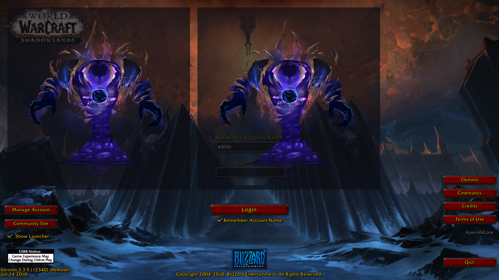

# wxl.modern-m2 (x64)

Loads models authored for newer versions of the game (`MD21` containers, inner versions 272–274)
natively in the recompiled x64 client. This is a port of
[manatactical/wxl-modern-m2](https://github.com/manatactical/wxl-modern-m2) at `7f793b1`, a 32-bit
WarcraftXL extension, to the x64 mod ABI (`abi` 0.5, `win-x64`).



## How it attaches

The 32-bit extension detoured the client's loader and renderer at fixed addresses. The x64 runtime
has no detours. Instead:

- **Format work stays in this mod.** Upstream's reader runs at four points of the client's loader,
  which the new **`wxl.m2file`** service hands over (core seams `M2.LoadSucceededCallback`,
  `M2.Initialize`, `M2.InitializeSkinProfile`, `M2.FinishLoadingLowPrioritySequence`):

  | Stage | Upstream hook | What runs (file) |
  |---|---|---|
  | `WXL_M2FILE_READ` | `M2.Init` (0x83CF00) | container demux, body slid in place, sequence/material deltas, particle and camera normalization (`load/NativeLoad.cpp`, `M2Demux`, `M2Fixups`, `M2Normalize*`) |
  | `WXL_M2FILE_PARSED` | after upstream's own walk | TXID texture names, ribbon/camera clamps, shadow animate gate |
  | `WXL_M2FILE_SKIN` | `M2.FinalizeSkin` (0x837A40) | bone-budget split, material/texunit contract rebuild (`compat/`) |
  | `WXL_M2FILE_SEQUENCE` | `M2.AnimLoadComplete` | `AFM2` external animation unwrap (`load/AnimUnwrap.cpp`) |

- **Engine work moved into the client source.** These are fixes to the client, not knowledge of a
  format:
  - wide submesh index starts, `(level << 16) | indexStart` when in bounds (wxl-core's
    `m2native-indices`, upstream's DIP start-index expansion): `Engine/Source/Model2/M2Data.h`,
    `M2Shared.cpp`, `M2Model.cpp`, `M2Scene.cpp`, `CM2SceneRender.cpp`;
  - packed shader ids past the client's three no longer crash `CM2Shared::GetEffect` (upstream's
    `BuildBatchMaterial` guard);
  - texture files over 4 MB (2048 DXT5) are read instead of waiting forever, and the decode
    scratch holds 2048 chains (wxl-core's "modern-blp mip scratch"): `Engine/Source/Services/Texture.cpp`.

The client keeps a model's arrays as 32-bit offsets relative to the array itself. Upstream pointed
arrays at `malloc`'d memory, which a 32-bit offset may not reach on x64. Replacement arrays come
from `wxl.m2file`'s `alloc_near` instead. After the read stage, the client's own parser walks the
body. Upstream walked it itself, because the 32-bit parser could not be handed a modern body. The
header's version is therefore set to 264 for that parse.

## Textures by FileDataID

Upstream asked `wxl-db2`'s `wxl.fdid`, which has no x64 counterpart. The mod resolves an id from,
in order:

1. the wow.export manifest beside the model (`<model>.manifest.json`);
2. `<mod>\listfile.csv` (`id;path` lines);
3. wow.export's naming `<model folder>\<model>_<id>.blp`.

## Ported / not ported

| Upstream feature | x64 |
|---|---|
| Native MD21 read (demux, in-place slide, no host conversion) | ported |
| Record normalization (particles, cameras) | ported (verbatim) |
| Sequence/material deltas, LDV1 profile clamp, SKID refusal | ported |
| TXID texture names | ported (manifest / listfile / naming resolver instead of `wxl.fdid`) |
| Ribbon / camera reference clamps | ported |
| Shadow animate gate | ported (`wxl.m2file` `animate_bones`) |
| Bone-budget split (75 bones per draw) | ported; wide starts follow the client's in-bounds rule instead of upstream's path rule |
| Shader-id decode, texUnitLookup / combiner synthesis, render-flag fix | ported |
| `AFM2` .anim unwrap | ported |
| 32-bit index starts | in the client |
| `BuildBatchMaterial` crash guard | in the client |
| Large-M2 memory arena (`wxl.m2arena`) | not needed: a 32-bit address-space fix |
| Add-alpha combiner shader (`CombinerPatch`, effects 21/33/35) | not ported: those batches draw with the decoded two-texture blend |
| Alpha-key cutoff 0.5 for modern models (`SetupMaterial`) | not ported |
| Multi-layer ribbon combine (`RibbonDraw` / DIP) | not ported |
| Particle screen blend (`EmitterBlend`) | not ported |
| Shadow co-instance buffer rebind (`RenderBatchShadowMap`) | not ported |
| Hit-test / opaque-sort fault guards | not ported (32-bit stale-pointer guards) |
| LOD skin variants (`$LODnn`) | not ported |
| `wxl.m2draw` one-shot DIP interceptor | not ported (`wxl.gx` covers batch watching) |
| `.skel` split skeletons | refused at load, as upstream |

## Settings

`<mod>\wxl-modern-m2.cfg`, `Name=Value`:

- `Enabled=0` turns the mod off.
- `BoneSplit=0` turns off the bone split.

## Requirements

The `wxl.m2file` service and the client loader seams, on the `x64-port` branch of
[Tyrallis/client](https://github.com/Tyrallis/client/tree/x64-port), [Tyrallis/core](https://github.com/Tyrallis/core/tree/x64-port) and
[Tyrallis/sdk](https://github.com/Tyrallis/sdk/tree/x64-port). The client must be built with
`-DWOWDECOMP_DISABLE_SIGNATURE_CHECKS=ON` to load unsigned model patches.

## Building

Needs a checkout of the WarcraftXL SDK (`x64-port` branch) at `../../sdk`, or pass `-DWXL_SDK_DIR=...`.
Build with Visual Studio 2022: the 2026 Insiders compiler (MSVC 14.50) crashes on the SDK's headers. Since 1.1.0 the mod needs the client and SDK of `x64-port` at WarcraftXL ABI 0.1.15; older clients refuse it.

```
cmake -S . -B build -G "Visual Studio 18 2026"
cmake --build build --config Release
```

The mod folder is `build/dist/wxl.modern-m2`. Copy it to `<client>\Mods\`.

GPL-3.0-or-later, as upstream (see `LICENSE`).
